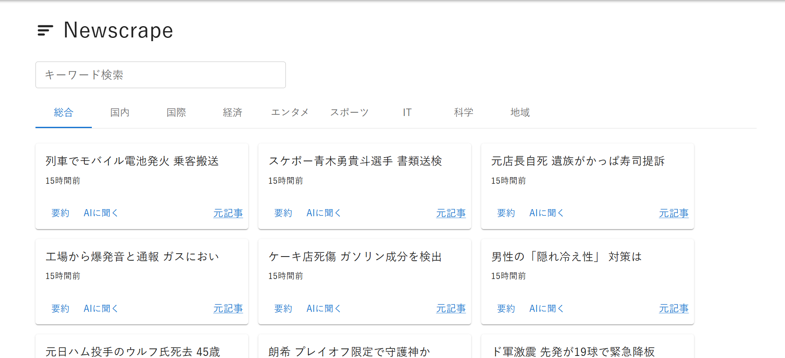
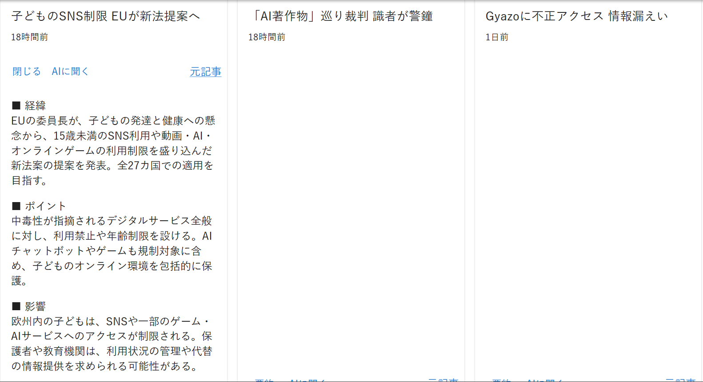
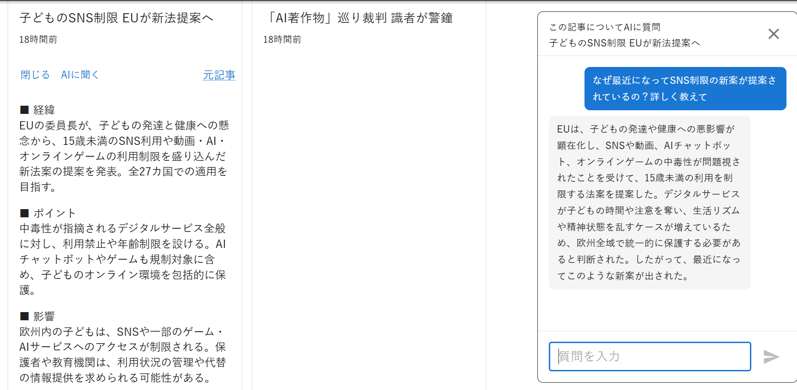
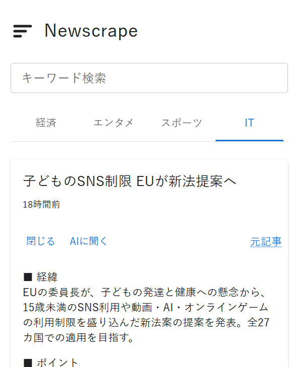

# Newscrape

広告や視覚的ノイズを排除し、主要ニュースを要約付きで最短で読むためのWebアプリ。

**ライブ:** https://newscrape-front.rknd24.workers.dev/

Yahoo! ニュースの各カテゴリRSSを定期的に取り込み、記事本文をAIで「経緯 / ポイント / 影響」の3段に要約する。ユーザーは一覧をスキャンし、気になった記事だけ要約を展開して、必要なら元記事へ飛ぶ。

要約を読んで疑問が湧いた記事は、カードの「AIに聞く」からその記事に絞ってAIに質問できる。記事本文を文脈に渡すので、要約より一段踏み込んだ説明が返る。

もとはCLIツールとして作り、その後 FastAPI + React に再構築し、本番デプロイまで持っていった。

## スクリーンショット

| 一覧画面 | 記事グリッド |
|---|---|
|  |  |

| AIに質問 | スマホ表示 |
|---|---|
|  |  |

## 構成

```
ブラウザ
  │ HTTPS
Cloudflare Workers（静的アセット）        フロントのビルド済みファイル
  │ HTTP  (VITE_API_BASE で注入したURL)
Vercel Functions（Singapore, sin1）       app.py (FastAPI) をサーバーレスで実行
  │ SQL  (DATABASE_URL)
Neon（サーバーレス Postgres, Singapore）  記事と要約の保存先

GitHub Actions cron（数時間おき、GitHub側の制約で間隔は不定）  python ingest.py を別マシンで実行し Neon に書き込む
LLM: Groq / openai/gpt-oss-120b         要約生成と記事チャット
```

すべて無料枠。フロントとバックは別デプロイで、`git push` すると Vercel と Cloudflare が自動で再デプロイする。関数のリージョンは `vercel.json` で DB と同じ Singapore に固定している。

## 設計上の判断

### 要約はユーザーのリクエスト時ではなく、取り込み時に事前生成する

当初は「ボタンを押す → その場でスクレイピング → AIに投げる → 数秒待たせる」だった。APIのレイテンシが1〜15秒とムラがあり制御できないため、要約をユーザーの経路から外した。

`ingest.py` の `generate_summaries()` が取り込みのたびに要約も作って `summary` カラムを埋める。ユーザーがボタンを押した時点では常にキャッシュヒットで体感ゼロ秒。

- 体感速度: 数秒待ち → ほぼゼロ
- API消費: 同じ記事を何人が見ても要約の生成は1回だけ
- 障害耐性: LLM側が落ちていても既存の要約は読める

`POST /analyze` はフォールバックとして残してある。事前生成が間に合っていない記事は、その場で生成して保存する。

### LLMクライアントを1クラスに隔離

`Newscrape.py` の `AIAnalyzer` がLLM呼び出しの唯一の場所。Gemini（無料枠20リクエスト/日、有料は前払い）から Groq（現在は openai/gpt-oss-120b）へ乗り換えたとき、変更はこのクラスと環境変数名だけで済んだ。app.py と ingest.py のロジックは無変更。

### 取り込みをWebプロセスから分離

取り込みは元々アプリ内のスケジューラ（APScheduler）で回していた。それだとアプリが寝ると取り込みも止まる。GitHub Actions の cron に出したことで、APIがスリープしても取り込みは続く。`ENABLE_SCHEDULER` 環境変数で本番はオフ、ローカルはオン。

### 記事は4日でDBから物理削除する

Yahoo! トピックスの記事は数日で鮮度が落ちる。ためこむと総合タブや記事チャットの文脈が古い記事で薄まり、DBも肥大化し続ける。そこで一覧から見えなくするだけでなく、`ingest.py` の `prune_old()` が `fetched_at` が4日より古い記事を毎回の取り込み時に `DELETE` している。一覧に出ない記事はDBにも残っていない。

### 記事チャットは一覧横断ではなく1記事にフォーカスする

最初は「画面に表示中の記事すべての要約」を文脈に入れていた。試すと答えが浅く一般的だった。ユーザーが気にしていない20記事分の要約を平均していたのが原因。

「もっと詳しく」という疑問は必ず特定の記事から生まれる。そこで各カードに「AIに聞く」を置き、押すとその1記事だけに絞って `body_text`（本文）を文脈に渡す形にした。文脈が小さいので速く、トークン制限にも余裕があり、会話もその記事に閉じる。

既知の弱点として、記事に書かれていない比較や憶測を聞かれると、モデルが学習知識で埋めて事実と異なる回答をすることがある。プロンプトで記事の範囲に寄せているが、完全には防げない。

### 記事チャットはストリーミングで返す

当初はGroqの回答が全部できあがるまで待ってから、1回でまとめて返していた。質問によっては体感の待ち時間が長く、ChatGPTのように文字が少しずつ表示される方が自然だと考え、Groq → FastAPI → フロントの3層をストリーミング対応に変更した。

- Groq側は `stream=True` で、回答を断片（chunk）ごとに受け取る
- `AIAnalyzer.chat()` は `return` で完成品を返す関数から、`yield` で断片を順に渡すジェネレータに変更
- `/chat` は `StreamingResponse` でジェネレータをそのままHTTPレスポンスに流し込む（`response_model` は使えないため外した）
- フロントは `response.body.getReader()` で断片を読み、`TextDecoder` で文字列化し、コールバックで1つのメッセージを少しずつ伸ばしていく

## 技術スタック

| 層 | 使用技術 |
|---|---|
| フロント | React 19 / TypeScript / Vite / MUI |
| API | FastAPI / SQLAlchemy 2.0 / Pydantic |
| DB | PostgreSQL（Neon）/ 開発は SQLite |
| 取り込み | requests + BeautifulSoup（スクレイピング）、標準ライブラリ（RSSパース） |
| LLM | Groq API（openai/gpt-oss-120b） |
| インフラ | Cloudflare Workers / Vercel / GitHub Actions |

## ローカルで動かす

必要な環境変数:

- `GROQ_API_KEY` — Groq のAPIキー
- `DATABASE_URL` — 未設定ならローカルの SQLite (`sqlite:///./newscrape.db`) を使う

### バックエンド（FastAPI）

```
pip install -r requirements.txt
python -m uvicorn app:app --reload --port 8000
```

### フロントエンド（React + Vite）

```
cd newscrape-front
npm install
npm run dev
```

開発サーバーは `localhost:5180`。`vite.config.ts` の proxy が `/news` `/analyze` `/chat` を `localhost:8000` に転送する。

### 取り込み（RSS取得 + 要約生成）

```
python ingest.py
```

### テスト

```
python -m pytest
```

`conftest.py` が一時ファイルのSQLiteに差し替えるので、開発用DBには影響しない。

## 注意

個人の学習目的で作っている。Yahoo! ニュースのRSSと記事本文を扱うが、公開しているのは自作のAI要約と元記事へのリンクのみで、記事本文そのものは配信していない。
