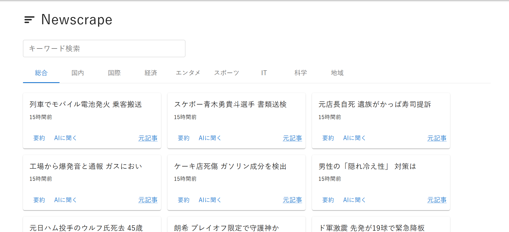
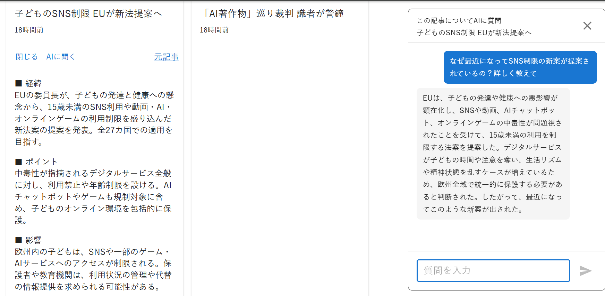
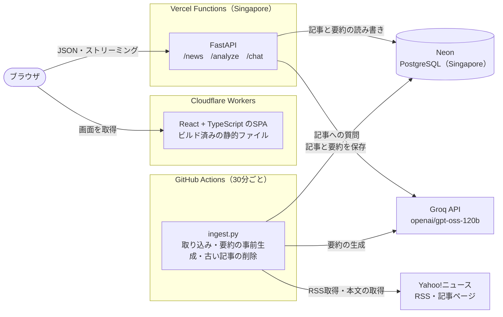
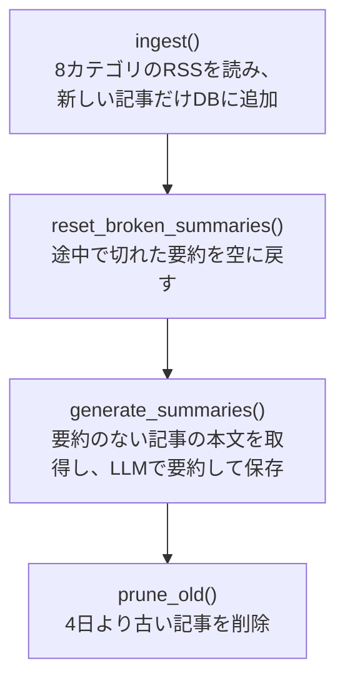

# Newscrape

広告や関連記事の誘導なしで、主要ニュースをAIの要約つきで読むためのWebアプリ。

[](https://github.com/rknd24/Newscrape/actions/workflows/ingest.yml)
[](https://github.com/rknd24/Newscrape/actions/workflows/test.yml)


**公開URL：https://newscrape-front.rknd24.workers.dev/** （ログイン不要）

| 一覧 | 要約とAIへの質問 |
|---|---|
|  |  |

## できること

- Yahoo!ニュース トピックスの記事を、9つのタブ（総合・国内・国際・経済・エンタメ・スポーツ・IT・科学・地域）で一覧できる
- 「要約」を押すと、**経緯 / ポイント / 影響** の3段にまとめた要約が開く。要約は事前に作ってあるので、待ち時間はない
- 「AIに聞く」を押すと、その記事だけを対象にAIへ質問できる。回答は書かれた分から順に表示される
- キーワード検索ができる。見出しだけでなく本文も対象
- 気になった記事は「元記事」からYahoo!ニュースの記事へ移動できる
- 記事の取り込みと要約は30分ごとに自動で行い、4日たった記事は削除する

## なぜ作ったか

ニュースを読むとき、広告や関連記事の誘導が多くて集中できないのが不満だった。主要ニュースの要点だけを、余計なものなしで読める場所がほしくて作った。商用目的ではなく、まず自分が使うためのもの。

2026年4月に、ターミナルで動くCLIツールとして作り始めた。6月にFastAPIでWeb化し、8〜9月にフロントをReact + TypeScriptで書き直して公開した。

### 使ってみて直したこと

作って終わりにせず、自分と母が使って気づいた不便を、設計の変更で直してきた。

| 気づいた人 | 使って気づいたこと | 変えたこと |
|---|---|---|
| 自分 | 「要約」を押してから数秒〜十数秒待たされると、読む気が落ちる | 要約を、押されたときではなく記事の取り込み時に作っておく構成に変えた |
| 母 | 「大谷」では見つかる記事が、「大谷翔平」では見つからないと指摘された。検索が見出しだけを対象にしていたのが原因だった | 本文も検索対象にし、全カテゴリを横断して探せるようにした |
| 自分 | AIへの質問の答えが浅く、どの記事にも当てはまるような内容になる | 表示中の全記事ではなく、選んだ1記事の本文だけをAIに渡す形に変えた |
| 自分 | 長い回答が一度にまとめて表示されると読みにくい。少しずつ表示されるほうが、心理的に読みやすい | 回答を、書かれた分から順に表示するストリーミングに変えた |

それぞれの詳しい経緯は「[設計上の判断](#設計上の判断)」に書いた。

## 構成



- フロントとAPIは別々にデプロイしている。ブラウザはAPIを直接呼ぶ（APIのURLはビルド時に `VITE_API_BASE` で渡す）
- 記事の取り込みと要約は、APIとは別のマシン（GitHub Actions）で動く。ユーザーのリクエストの中ではLLMを待たない
- Vercelの関数は、`vercel.json` でDBと同じSingaporeリージョンに固定している
- `main` にpushすると、VercelとCloudflareがそれぞれ自動で再デプロイする
- すべて無料枠で動かしている

### 取り込みバッチの流れ

GitHub Actionsが毎時7分と37分に `python ingest.py` を実行する。



## 設計上の判断

### 要約は、押されたときではなく取り込み時に作る

最初は「ボタンを押す → その場で記事を取得 → LLMに投げる」という作りだった。LLMの応答は1〜15秒とばらつきがあり、こちらでは制御できない。そこで、要約の生成をユーザーの操作の経路から外した。

- `ingest.py` の `generate_summaries()` が、取り込みのたびに要約を作って `summary` カラムに保存する
- 一覧のAPIが要約も一緒に返すので、「要約」を押したときは通信なしで開く
- 同じ記事を何人が見ても、要約の生成は1回で済む
- LLM側が止まっていても、作成済みの要約は読める

引き換えに、新しい記事が一覧に出るまで、取り込みの間隔のぶんだけ遅れる。Newscrapeの目的は読むときの邪魔をなくすことなので、反映の遅れよりも、待たされる不便のほうが重いと判断した。

事前生成が間に合っていない記事のために、その場で要約を作る `POST /analyze` も残している。

### 取り込みをWebのプロセスから分ける

取り込みは、もともとアプリ内のスケジューラ（APScheduler）で回していた。この作りだと、アプリが止まると取り込みも止まる。取り込みをGitHub Actionsの定期実行に出したことで、APIの状態に関係なく続くようになった。

環境変数 `ENABLE_SCHEDULER` で切り替えられ、本番ではオフにしている。

### LLMの呼び出しを1つのクラスにまとめる

LLMを呼ぶ場所は、`Newscrape.py` の `AIAnalyzer` だけにしている。要約のLLMをGeminiからGroqへ乗り換えたとき、変更はこのクラスと環境変数名だけで済んだ。`app.py` と `ingest.py` は変えていない。

### AIへの質問は、1つの記事に絞る

最初は、画面に表示中の記事すべての要約をAIに渡していた。試すと、答えが浅く一般的だった。ユーザーが気にしていない記事の要約まで混ざっていたのが原因だった。

「もっと詳しく知りたい」という疑問は、特定の記事から生まれる。そこで各記事に「AIに聞く」を置き、押された1記事の本文だけを渡す形にした。渡す文章が少ないので応答が速く、会話もその記事の中で完結する。

### AIの回答はストリーミングで返す

最初は、回答が全部できあがってから1回で返していた。大量の文章が一度に表示されるより、少しずつ表示されるほうが心理的に読みやすい。自分で使っていてそう感じたので、書かれた分から順に表示する形に変えた。

- Groqからは `stream=True` で、回答を断片ごとに受け取る
- `AIAnalyzer.chat()` は、完成した文章を `return` する関数から、断片を `yield` するジェネレータに変えた
- `/chat` は `StreamingResponse` で、ジェネレータをそのままHTTPレスポンスに流す
- フロントは `response.body.getReader()` で断片を読み、1つのメッセージに少しずつ足していく

### 壊れた要約は、次のバッチで作り直す

LLMの出力が途中で切れ、3段目の「影響」が欠けた要約が保存されることがあった。`reset_broken_summaries()` が、こうした要約を取り込みのたびに見つけて空に戻す。空に戻した記事は、同じバッチの中で要約を作り直す。

### 記事は4日でDBから削除する

Yahoo!ニュース トピックスの記事は、数日で鮮度が落ちる。ためこむと、総合タブが古い記事で埋まり、DBも増え続ける。`prune_old()` が、取り込みから4日たった記事を毎回のバッチで削除している。

## 技術スタック

| 層 | 技術 | 役割 |
|---|---|---|
| フロント | React 19 / TypeScript / Vite / MUI | 一覧・要約・チャットの画面（SPA） |
| API | FastAPI / SQLAlchemy 2.0 / Pydantic | 記事一覧、要約、記事への質問 |
| DB | PostgreSQL（Neon）、開発時はSQLite | 記事と要約の保存 |
| 取り込み | requests / BeautifulSoup / 標準ライブラリ | RSSの読み取りと記事本文の取得 |
| LLM | Groq API（openai/gpt-oss-120b） | 要約の生成と、記事への質問の回答 |
| ホスティング | Cloudflare Workers / Vercel | フロントの配信 / APIの実行 |
| 定期実行・CI | GitHub Actions | 30分ごとの取り込みバッチ、pushのたびのテストとビルド |
| テスト | pytest | APIと履歴保存のテスト |

### 選んだ理由・変えた理由

- **React**：ニュースをノイズなくスムーズに読むという目的には、SPAが合っている。SPAを作るうえで、エコシステムが豊富なReactを選んだ
- **MUI**：CSSを自分で書くより、完成された部品を使うほうが時間を短縮できると考えた
- **FastAPI**：Pydanticで型を定義して、レスポンスの形を決められる。Swagger UIで、エンドポイントを画面から試せる
- **Cloudflare Workers**：無料枠で使える帯域が、ほかのホスティングサービスより広かった
- **Gemini → Groq**：Geminiの無料枠では、1日に20件までしか要約できなかった。有料枠は前払いが必要で、個人開発には負担が大きかった。推論が速いGroqに変えて、より多くの記事を要約できるようになった
- **Render → Vercel**：Renderの無料枠は月750時間。スリープを防ぐために常に起動させておくと、月744時間（24時間×31日）を使い、上限にほぼ届く。VercelがFastAPIとストリーミングの両方に対応していることを公式ドキュメントで確認し、移行した。Vercelはリクエストが来たときだけ関数が動く方式なので、スリープを防ぐ仕組みそのものが要らなくなった
- **APScheduler → GitHub Actions**：アプリ内のスケジューラだと、アプリが止まると取り込みも止まるため、アプリの外に出した
- **開発時はSQLite**：`DATABASE_URL` を設定しなければSQLiteのファイルを使うので、ローカルではDBの準備なしで動く

## AIとの分担

開発にはAI（Claude Code）を使っている。進め方は、まず自分でコードを書き、分からないところはAIに書いてもらい、納得するまで質問する、という順番。どこを自分で決め、どこをAIに任せたかを書いておく。

| 区分 | 内容 |
|---|---|
| 自分で判断した | 要約を事前に作る構成、取り込みをWebのプロセスから分けること、LLMの呼び出しを1つのクラスにまとめること、AIへの質問を1記事に絞ること、ストリーミング化、GeminiからGroqへの変更、RenderからVercelへの移行 |
| AIが書いた・AIの案を採用した | テーブルの設計、取り込みバッチ（`ingest.py`）のコード、定期実行にGitHub Actionsを使うこと |
| 自分で書くと決めている | Reactのstate・ロジック・JSX、APIのエンドポイントのロジック、テストコード。テストの土台、CIのyaml、デプロイ設定などの環境まわりはAIに任せてよいことにしている（[CLAUDE.md](CLAUDE.md)） |

AIに書いてもらって理解した部分は、分かったつもりで終わりやすかった。この反省から、次の制作物 [WebCraft](https://github.com/rknd24/webcraft) ではDB設計から自分で行っている。

## ディレクトリ構成

```
Newscrape/
├── app.py                  # FastAPI本体（/news, /analyze, /chat, /health）
├── Newscrape.py            # AIAnalyzer（LLMの呼び出し）、NewsFetcher（RSS取得・本文の取得）、初期のCLI
├── ingest.py               # 取り込みバッチ（GitHub Actionsから実行）
├── models.py               # テーブル定義（articles）
├── schemas.py              # APIのリクエスト・レスポンスの型（Pydantic）
├── database.py             # DB接続。DATABASE_URLがなければSQLiteを使う
├── migrate_to_neon.py      # SQLiteからNeonへ記事を移したときのスクリプト
├── conftest.py             # テスト用のDBに差し替える設定
├── tests/                  # pytestのテスト
├── requirements.txt
├── vercel.json             # Vercelの関数のリージョン指定
├── .github/workflows/
│   ├── ingest.yml          # 30分ごとの取り込み
│   └── test.yml            # pushのたびにpytestとフロントのビルドを実行
├── docs/                   # スクリーンショット
└── newscrape-front/        # フロント（React + TypeScript + Vite）
    ├── src/
    │   ├── api.ts          # APIの呼び出しと型
    │   ├── App.tsx
    │   ├── theme.ts        # MUIのテーマ
    │   └── components/
    │       ├── ArticleList.tsx   # タブ・検索・記事一覧
    │       ├── ArticleCard.tsx   # 記事1件と要約の開閉
    │       ├── SearchBar.tsx
    │       ├── ChatPanel.tsx     # AIへの質問パネルの枠
    │       ├── Chat.tsx          # 会話の表示と送信
    │       └── Logo.tsx
    ├── vite.config.ts      # 開発サーバーの設定（APIへのproxy）
    └── wrangler.jsonc      # Cloudflare Workersの設定
```

## API

| メソッド | パス | 内容 |
|---|---|---|
| GET | `/news/{category_id}` | 記事の一覧を新しい順に30件返す。`all` で全カテゴリ。`?q=` で見出しと本文を検索 |
| POST | `/analyze` | 要約がまだない記事の要約を、その場で作って保存する |
| POST | `/chat` | 1つの記事について質問する。回答はストリーミングで返る |
| GET | `/health` | 動作確認用 |

DBのテーブルは `articles` の1つ（`id` / `title` / `link` / `category` / `fetched_at` / `body_text` / `summary`）。

## ローカルで動かす

### 環境変数

| 名前 | 必須 | 内容 |
|---|---|---|
| `GROQ_API_KEY` | 必須 | GroqのAPIキー。ないとAPIが起動しない |
| `DATABASE_URL` | 任意 | PostgreSQLの接続先。設定しなければ `sqlite:///./newscrape.db` を使う |
| `ENABLE_SCHEDULER` | 任意 | 既定は `1`。APIの起動時と、その後30分ごとに取り込みが動く。止めるときは `0` |
| `ALLOWED_ORIGINS` | 任意 | CORSで許可するオリジン（カンマ区切り）。設定しなければ全許可 |

`ENABLE_SCHEDULER` が既定のままだと、APIを起動した時点で記事の取り込みと要約の生成が始まり、Groqの利用枠を使う。

### バックエンド（FastAPI）

```bash
git clone https://github.com/rknd24/Newscrape.git
cd Newscrape
python -m venv .venv
source .venv/bin/activate          # Windows（PowerShell）: .venv\Scripts\Activate.ps1
pip install -r requirements.txt

export GROQ_API_KEY="自分のキー"    # Windows（PowerShell）: $env:GROQ_API_KEY="自分のキー"
python -m uvicorn app:app --reload --port 8000
```

APIの仕様は http://localhost:8000/docs で確認できる。GitHub ActionsではPython 3.12で動かしている。

### フロントエンド（React + Vite）

```bash
cd newscrape-front
npm install
npm run dev
```

http://localhost:5180 で開く。`vite.config.ts` のproxyが、`/news` `/analyze` `/chat` を `localhost:8000` に転送する。

### 取り込みだけを手動で実行する

```bash
python ingest.py
```

### テスト

```bash
python -m pytest
```

`conftest.py` が一時ファイルのSQLiteに差し替えるので、開発用のDBには影響しない。

pushとプルリクエストのたびに、GitHub Actionsがpytestと、フロントのlint・ビルドを実行する。

## 既知の課題

- テストは3本だけ（`/health`、`/news`、履歴保存）。`/analyze`、`/chat`、`ingest.py` にはテストがない
- GitHub Actionsの定期実行は、GitHub側の混雑で遅れたり飛ばされたりする。30分ごとは設定上の間隔で、実際の間隔は一定ではない
- 記事に書かれていない比較や推測を聞かれると、LLMが学習した知識で補い、事実と違う回答をすることがある。プロンプトで記事の範囲に寄せているが、完全には防げない
- 本文の取得は、Yahoo!ニュースのページのHTML構造に依存している。構造が変わると取得できなくなる
- 検索は部分一致。表記ゆれ（ひらがなと漢字など）には対応していない

## 注意

個人の学習目的で作っている。Yahoo!ニュースのRSSと記事本文を扱うが、公開しているのは自作のAI要約と元記事へのリンクだけで、記事本文そのものは配信していない。
